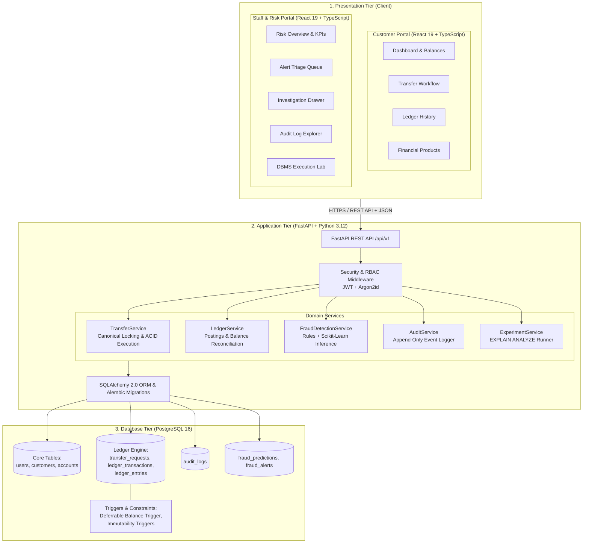
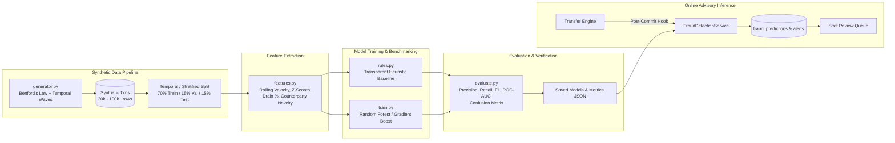

# FinLedger-AI — System Architecture

**Document:** System Architecture Specification  
**Status:** Approved  
**Related Documents:** [implementation_plan.md](file:///c:/Users/Saksham%20Raj/Downloads/bin/Game,Project/Projects/FinLedger-AI/docs/implementation_plan.md), [database_invariants.md](file:///c:/Users/Saksham%20Raj/Downloads/bin/Game,Project/Projects/FinLedger-AI/docs/database_invariants.md)

---

## 1. Architectural Philosophy & Principles

FinLedger-AI is designed as an auditable, high-integrity financial transaction platform paired with machine-learning-assisted fraud detection. The architectural design adheres to four non-negotiable core principles:

1. **Relational Database as the Single Source of Truth**:  
   Financial balances and historical records are strictly determined by committed relational ledger entries in PostgreSQL. Application services and frontend caches derive their state from the database; they never manufacture or overwrite balances independently.

2. **Strict Separation of Financial Execution and AI Inference**:  
   Machine learning models and heuristic rules operate strictly in an **advisory and auditing capacity**. An AI algorithm may flag a transaction as suspicious, generate human-readable explanations, and dispatch alerts to a staff queue, but it is **architecturally prohibited** from directly altering balances, rejecting database transactions, or freezing accounts autonomously.

3. **Double-Entry Bookkeeping & Ledger Immutability**:  
   Every monetary movement generates balanced debit and credit legs within a single atomic database transaction. Once committed, ledger entries cannot be updated or deleted. Corrections must take the form of explicit reversing transactions.

4. **Deterministic Concurrency & Scoped Idempotency**:  
   Transactions acquire row locks in a predetermined canonical order to eliminate deadlocks. Network retries are handled gracefully via scoped idempotency keys that guarantee exactly-once execution semantics.

---

## 2. Three-Tier System Architecture

---

## 3. Tier 1: Presentation Tier (Frontend)

The frontend is a modern single-page application (SPA) built using **React 19**, **TypeScript**, **Vite**, and **Tailwind CSS**.

### 3.1 Responsibilities & Modules
- **Authentication & Session Management**:
  - Stores JWT access tokens in memory (with local fallback).
  - Evaluates user roles (`CUSTOMER`, `STAFF`, `ADMIN`) to route traffic to appropriate layouts and enforce client-side navigation restrictions.
- **Customer Portal**:
  - **Account Overview**: Real-time balance cards (Savings, Current, Investments) with copyable account identifiers.
  - **Transfer Flow**: Multi-step transfer wizard:
    1. Input details (source, destination, amount in INR, description).
    2. Review fees (₹0.00) and debit/credit preview.
    3. Client generates a unique `UUIDv4` idempotency key per transaction intent to prevent duplicate submissions on double-clicks or unstable networks.
    4. Receipt modal confirming status (`POSTED`) and remaining balance.
  - **Transaction History**: Paginated, filterable data table displaying debits, credits, timestamps, and counterparties with CSV export.
  - **Simulated Products**: Catalog of Fixed Deposits and Liquid Mutual Funds with simulated interest return projections.
  - **Staff & Risk Portal**:
  - **Risk Overview**: Key performance indicators (pending alerts, false-positive ratios, flagged volume).
  - **Alert Triage Queue**: Table of scored transactions with color-coded risk severity tags (High, Medium, Low) and review status filters.
  - **Investigation Drawer**: Detailed view for flagged transactions showing rule triggers, ML risk score, feature contributions (e.g. velocity, z-score), and a staff decision form with canonical options: `CLEARED` (Clear Alert / False Positive), `CONFIRMED_FRAUD` (Confirm Fraudulent Transaction), and `ESCALATED` (Escalate to Senior Compliance) with mandatory review notes.
  - **Audit Explorer**: Tamper-evident administrative action log viewer with formatted JSON metadata inspection.
  - **DBMS Lab**: Interactive SQL query performance visualization showing live `EXPLAIN (ANALYZE, BUFFERS)` execution trees and index performance comparisons (with all baseline timings treated as illustrative estimates until measured).

---

## 4. Tier 2: Application Tier (Backend)

The backend is built with **FastAPI** (Python 3.12), leveraging asynchronous request handling, **Pydantic v2** for rigorous schema validation, and **SQLAlchemy 2.0** for object-relational mapping.

### 4.1 Layered Responsibilities
- **API Boundary (`app/api/v1/`)**:
  - Enforces request validation using Pydantic models.
  - Injects database sessions with scoped lifecycles.
  - Gathers authentication credentials, validates tokens, and asserts role authorizations via FastAPI dependencies (`deps.py`).
- **Core Domain Services (`app/services/`)**:
  - **`TransferService`**:
    - Coordinates the transfer transaction lifecycle using a **Two-Phase / Independent Transaction Architecture**:
      1. `financial_txn`: Resolves idempotency token, acquires canonical row locks (`SELECT ... FOR UPDATE`), validates funds. If successful, posts double-entry ledger entries and updates cached balances atomically. If validation fails (insufficient funds, invalid account), `financial_txn` is completely rolled back.
      2. `audit_txn`: When a transfer fails, an independent database transaction commits `transfer_requests` (`status = 'FAILED'`, failure reason) and emits `audit_logs` (`action = 'TRANSFER_FAILED'`). This ensures failed financial attempts **never erase required audit evidence**.
  - **`LedgerService`**:
    - Executes ledger queries, running balance calculations, and opening balance postings.
    - Houses the **Balance Reconciliation Engine**, which verifies that account cached balances match the exact sum of ledger postings across the entire database.
  - **`FraudDetectionService`**:
    - Computes feature snapshots for outgoing transfers (rolling velocity, customer history deviation, time-of-day).
    - Evaluates heuristic baseline rules.
    - Executes Scikit-Learn inference pipelines to produce a risk score ($[0.0, 1.0]$) and human-readable explanation.
    - Inserts `fraud_predictions` records and dispatches alerts (`review_status = 'PENDING'`) to the staff review queue.
  - **`AuditService`**:
    - Centralized, append-only logger recording security actions (logins, logouts), financial events (transfers, failures), and administrative decisions (alert resolutions).
    - Automatically redacts sensitive fields (passwords, tokens, credentials).
    - Can execute within an independent transaction scope to ensure failure audit records survive financial rollbacks.
  - **`ExperimentService`**:
    - Provides endpoints to seed reproducible synthetic data at configurable volumes.
    - Executes SQL benchmark queries using `EXPLAIN (ANALYZE, BUFFERS)` and returns structured execution plans, timing metrics, and buffer statistics.

---

## 5. Tier 3: Database Tier (PostgreSQL 16)

PostgreSQL serves as the core persistence engine and invariant enforcer.

### 5.1 Relational Architecture & Guarantees
- **Normalized Schema**: Eliminates update anomalies through 3NF normalization.
- **Relational Integrity**: Primary keys (UUIDv4/BigSerial), foreign keys with strict referential constraints (`ON DELETE RESTRICT` on financial records), and uniqueness constraints (`(source_user_id, idempotency_key)`).
- **PostgreSQL-Specific Invariant Enforcement**:
  - **Deferrable Constraint Triggers**: Ensures that multi-row ledger entries for every transaction balance out to zero ($\sum \text{Debits} - \sum \text{Credits} = 0$) at transaction commit time.
  - **Immutability Triggers**: `BEFORE UPDATE OR DELETE` triggers on `ledger_entries` and `audit_logs` raise exceptions, preventing modification or removal of committed records.
  - **Pessimistic Concurrency**: Row-level locking (`SELECT ... FOR UPDATE`) under `READ COMMITTED` ensures safe concurrent updates without race conditions or dirty reads.
- **Deployment Environments**: Native local PostgreSQL 16+ on Windows is fully supported as the primary developer setup (automated via PowerShell setup scripts), with Docker Compose provided as an optional portability alternative.
- **Database Migrations**: Version-controlled migrations managed via **Alembic**, ensuring deterministic schema upgrades across all deployment environments.

---

## 6. Machine Learning Subsystem Architecture

The ML subsystem provides transparent, auditable fraud detection capability.

### Key Architectural Characteristics of the ML Pipeline:
- **Reproducibility**: Parameterized random seed ensures consistent data generation across runs.
- **No Data Leakage**: Features are calculated strictly using information available prior to or at the moment of the transaction.
- **Comparative Evaluation**: The machine learning model is always compared against a transparent, rule-based baseline.
- **Explainability**: Every prediction includes human-interpretable rationale and feature snapshots saved in PostgreSQL for staff review.
- **Advisory Role**: The ML output is written to `fraud_predictions` and `fraud_alerts`; it never rolls back or halts a valid customer ledger posting autonomously.
