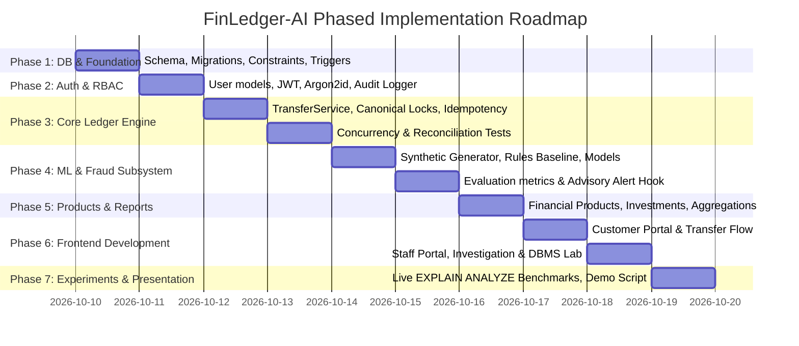

# FinLedger-AI — Phased Implementation Roadmap & Acceptance Criteria

**Document:** Phased Engineering Roadmap  
**Status:** Approved  
**Related Documents:** [implementation_plan.md](file:///c:/Users/Saksham%20Raj/Downloads/bin/Game,Project/Projects/FinLedger-AI/docs/implementation_plan.md), [database_invariants.md](file:///c:/Users/Saksham%20Raj/Downloads/bin/Game,Project/Projects/FinLedger-AI/docs/database_invariants.md)

---

## 1. Roadmap Overview & Execution Methodology

FinLedger-AI is developed in **seven strictly sequential phases**. Each phase has well-defined objectives, technical deliverables, and automated acceptance criteria that must pass before advancing to subsequent phases.

---

## 2. Phase 1: Database Foundation, Migrations & Schema Constraints

### Objectives
Establish the relational database infrastructure, PostgreSQL connection engine, declarative models, Alembic migrations, database-level check constraints, and integrity triggers.

### Deliverables
1. Local PostgreSQL database configuration & environment setup script supporting native local PostgreSQL 16+ on Windows (PowerShell scripts `scripts/setup_postgres_local.ps1`, `scripts/init_db.ps1`, `.env.example`) with optional `docker-compose.yml`.
2. SQLAlchemy 2.0 mapped models: `users`, `customers`, `accounts`, `transfer_requests`, `ledger_transactions`, `ledger_entries`, `audit_logs`, `fraud_predictions`, `financial_products`, `investments`.
3. Alembic migration scripts defining tables, primary keys, foreign keys (`ON DELETE RESTRICT`), unique constraints, and check constraints (`amount > 0`, `cached_balance >= 0`, `currency = 'INR'`).
4. Deferrable PostgreSQL constraint trigger (`trg_verify_ledger_balance`) ensuring $\sum \text{Debits} - \sum \text{Credits} = 0$ at transaction commit.
5. Immutability triggers on `ledger_entries` and `audit_logs` preventing SQL `UPDATE` and `DELETE` operations.

### Acceptance Criteria
- [x] `alembic upgrade head` runs cleanly on an empty local PostgreSQL database.
- [x] Database introspection script confirms all tables, constraints, foreign keys, and indexes exist.
- [x] Automated test demonstrates that committing an unbalanced ledger entry set raises an integrity exception and rolls back.
- [x] Automated test demonstrates that executing `UPDATE` or `DELETE` on `ledger_entries` or `audit_logs` raises an exception.

---

## 3. Phase 2: Authentication, Authorization & Security Architecture

### Objectives
Implement secure credential handling, stateless JWT authentication, role-based access control (RBAC), and append-only audit event logging.

### Deliverables
1. Password hashing using Argon2id/bcrypt (work factor 12) via `passlib[bcrypt]`.
2. JWT token issuance and verification service with 60-minute expiry.
3. FastAPI dependency guards: `get_current_user`, `require_customer`, `require_staff`, `require_admin`.
4. Append-only `AuditService` that logs user logins, logouts, and access attempts while automatically redacting sensitive credentials and tokens.
5. Seed script generating default demonstration accounts:
   - Customer: `rahul_sharma`
   - Staff: `priya_investigator`
   - Admin: `admin_system`

### Acceptance Criteria
- [x] Passwords stored in `users` are securely hashed; plaintext passwords never appear in database records or logs.
- [x] Valid credentials yield a signed JWT token; invalid credentials return HTTP 401.
- [x] Customer tokens accessing staff routes return HTTP 403 Forbidden.
- [x] Audit logs record login and access events with actor ID, action name, IP address, and sanitized metadata.

---

## 4. Phase 3: Core Double-Entry Ledger & Concurrency Engine

### Objectives
Implement the core financial transfer engine enforcing double-entry bookkeeping, canonical row-locking to prevent deadlocks, scoped idempotency, balance reconciliation, and independent audit persistence for failed attempts.

### Deliverables
1. `TransferService.execute_transfer` coordinating:
   - Scoped idempotency verification `(source_user_id, idempotency_key)` and payload SHA-256 hash comparison.
   - Canonical row locking: `SELECT ... FOR UPDATE` sorting account IDs $\min(A, B)$ then $\max(A, B)$.
   - Sufficient funds check under lock (`cached_balance >= amount`).
   - Atomic balanced posting: Debit source account, Credit destination account, update cached balances.
   - **Two-Phase / Independent Transaction Architecture**: Financial execution (`financial_txn`) cleanly rolls back on insufficient funds or validation errors, while failed transfer records (`transfer_requests` with `status = 'FAILED'`) and audit entries (`audit_logs` with `action = 'TRANSFER_FAILED'`) commit independently (`audit_txn`) so that failure audit evidence is never erased.
2. `LedgerService` containing the **Balance Reconciliation Engine**, asserting `cached_balance == sum(credits) - sum(debits)`.
3. High-concurrency test suite executing race condition simulations:
   - Concurrent double-spending test (competing withdrawals exhausting funds).
   - Bi-directional concurrent transfer test (A $\leftrightarrow$ B) verifying zero deadlocks.

### Acceptance Criteria
- [x] Successful transfer decreases source balance, increases destination balance, and records balanced ledger entries.
- [x] Insufficient funds transfer rolls back financial ledger entries cleanly while committing the failed transfer request and audit log in an independent transaction.
- [x] Replaying an identical transfer request returns the original cached result without duplicate posting.
- [x] Reusing an idempotency key with different payload parameters returns HTTP 409 Conflict.
- [x] Concurrent double-spending test with simultaneous competing withdrawals against a fixed balance permits exactly one to succeed and rejects the other for insufficient funds, leaving balance non-negative.
- [x] Bi-directional transfer test with parallel threads completes with zero deadlocks via canonical ascending row lock ordering.
- [x] System-wide balance reconciliation test reports 0 discrepancies across all accounts.

---

## 5. Phase 4: Synthetic Data Generator & AI Fraud Detection Pipeline

### Objectives
Construct a reproducible synthetic banking transaction generator, implement a transparent heuristic rule baseline, train and evaluate a Scikit-Learn fraud detection model, and integrate advisory fraud scoring into the transfer workflow.

### Deliverables
1. `backend/ml/generator.py`: Generates 20,000 to 100,000+ realistic synthetic transactions adhering to Benford's Law and diurnal banking cycles, with ~2-3% injected fraud scenarios (velocity bursts, amount outliers, rapid account draining, structuring).
2. `backend/ml/rules.py`: Transparent heuristic rule baseline (`VELOCITY_ALERT`, `ZSCORE_OUTLIER`, `RAPID_DRAIN`, `OFF_HOURS_HIGH_VALUE`).
3. `backend/ml/train.py` & `backend/ml/evaluate.py`:
   - Feature extraction pipeline (rolling velocity, customer history deviation, time-of-day).
   - Scikit-learn model training (`RandomForestClassifier`, `HistGradientBoostingClassifier`).
   - Strict 70% Train / 15% Val / 15% Test split.
   - Evaluation report computing Precision, Recall, F1-Score, ROC-AUC, and Confusion Matrix comparing Rule Baseline vs ML.
4. Advisory fraud scoring hook: Computes risk score and explanation for transfers and populates `fraud_predictions` and `fraud_alerts` with review status defaulting to `PENDING` (canonical enum: `PENDING`, `CLEARED`, `CONFIRMED_FRAUD`, `ESCALATED`).
5. Prominent academic disclaimer in reports and UI stating synthetic evaluation limits.

### Acceptance Criteria
- [x] Generator generates reproducible datasets with configurable random seeds.
- [x] Evaluation script outputs `evaluation_report.json` and confusion matrix plot comparing Rule Baseline vs ML.
- [x] Transfers with simulated fraud patterns trigger advisory alerts in `fraud_predictions` with risk score and human-readable explanation.
- [x] AI model execution never modifies account balances or rolls back valid financial transfers autonomously.

---

## 6. Phase 5: Financial Products, Investments & Reporting

### Objectives
Add simulated financial products (Fixed Deposits, Liquid Funds), double-entry investment purchases, and database-backed reporting summaries.

### Deliverables
1. Product catalog models and API endpoints: Fixed Deposits, Recurring Deposits, Mutual Funds.
2. Investment purchasing service: Debits customer savings account and credits simulated investment asset account.
3. System reporting queries:
   - Account balance distributions.
   - Daily transaction volume and value aggregations.
   - Fraud alert distribution by severity and review status (`PENDING`, `CLEARED`, `CONFIRMED_FRAUD`, `ESCALATED`).

### Acceptance Criteria
- [x] Purchasing an investment creates balanced double-entry ledger postings between savings and investment accounts.
- [x] Investment list API returns customer's active holdings with calculated current yield.
- [x] Reporting endpoints return aggregated metrics derived directly from database queries.

---

## 7. Phase 6: Frontend Development (React + TypeScript + Vite + Tailwind)

### Objectives
Develop a responsive, visually stunning fintech user interface with distinct customer and staff portals, real API integration, zero mocked transactions, and clear error handling.

### Deliverables
1. Design system: Custom Tailwind CSS tokens, dark/light theme, modern typography (Inter), status badges, accessible form inputs.
2. Customer Portal:
   - Overview dashboard with net worth, account cards, recent activity.
   - Transfer modal with client-side idempotency UUID generation, preview, and confirmation receipt.
   - Filterable ledger transaction history with CSV export.
   - Financial product catalog and investment manager.
3. Staff & Risk Portal:
   - Risk overview KPI cards (total volume, flagged volume, false-positive ratio).
   - Alert triage queue with severity badges (High, Medium, Low) and status filters (`PENDING`, `CLEARED`, `CONFIRMED_FRAUD`, `ESCALATED`).
   - Investigation drawer displaying rule triggers, ML risk score, feature contributions, and staff review decision form (`CLEARED`, `CONFIRMED_FRAUD`, `ESCALATED`) with mandatory review notes.
   - Universal audit log viewer with JSON metadata inspector.
   - DBMS query plan visualizer showing execution trees.

### Acceptance Criteria
- [ ] Frontend interacts 100% with real FastAPI endpoints (no mocked fake transactions).
- [ ] Customers can initiate transfers, observe live balance updates, and view ledger records.
- [ ] Staff can view flagged fraud alerts, inspect AI explanations, and submit review decisions (`CLEARED`, `CONFIRMED_FRAUD`, `ESCALATED`) with notes.
- [ ] All forms provide immediate input validation, error banners, and loading states.

---

## 8. Phase 7: DBMS Optimization Experiments, Documentation & Presentation Package

### Objectives
Benchmark representative queries before and after indexing using `EXPLAIN (ANALYZE, BUFFERS)`, generate complete project documentation, and prepare a presentation demo script.

> [!IMPORTANT]
> **Illustrative Estimates Notice**: All query timings and performance metrics mentioned during planning are illustrative targets and methodology baselines only. Actual empirical execution times and buffer stats will be measured and documented during this phase using PostgreSQL `EXPLAIN (ANALYZE, BUFFERS)`.

### Deliverables
1. Live DBMS performance experiments on 50,000+ synthetic ledger records:
   - Ledger history query before and after composite index `(account_id, created_at DESC)`.
   - Staff transaction search query before and after partial index on `transfer_requests`.
   - Unreviewed alert queue query before and after filtered index on `fraud_predictions`.
   - Results recorded in `docs/dbms_experiments.md` with execution plans, times, and buffer statistics.
2. Comprehensive documentation:
   - `README.md`: System overview, quickstart instructions, environment configuration.
   - `AGENTS.md`: Persistent engineering rules and invariants.
   - `docs/er_diagram.mermaid` & `docs/data_dictionary.md`: Relational models and schema dictionary.
   - `docs/architecture.md` & `docs/database_invariants.md`: Technical specifications.
   - `docs/ai_model_evaluation.md`: Comparative evaluation report and academic disclosure.
   - `docs/demo_script.md`: Step-by-step presentation script for professor demonstration.

### Acceptance Criteria
- [ ] DBMS experiment report documents measured `EXPLAIN (ANALYZE, BUFFERS)` outputs before and after indexing.
- [ ] Full automated test suite passes with 100% success rate.
- [ ] Demo script successfully guides a complete walkthrough of customer transfer, concurrency safety, AI fraud alert triage, and DBMS query optimization.
